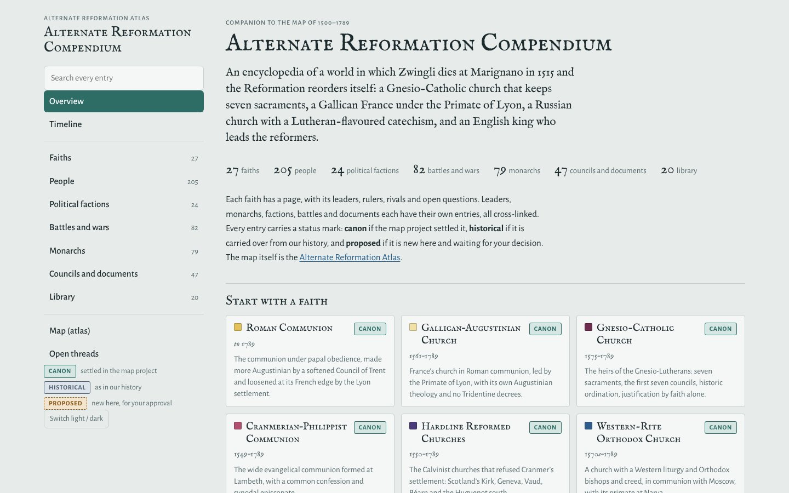
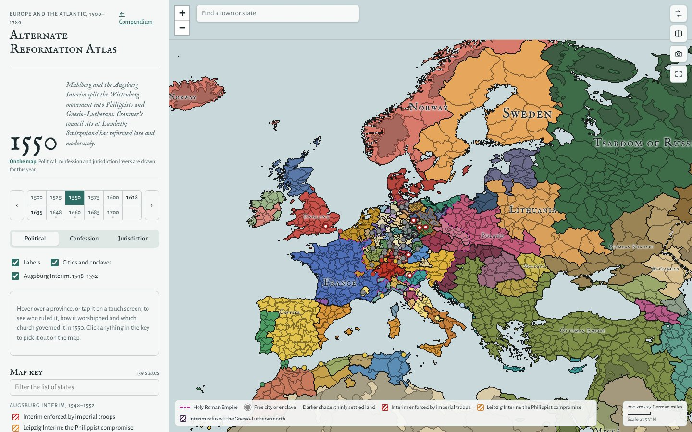

# Alternate Reformation Compendium

An encyclopedia and atlas for an alternate history in which Zwingli dies at Marignano in 1515 and the Reformation runs a different course, 1500–1789.

**[Open the Compendium →](https://jcalepos146.github.io/alternate-reformation-compendium/)** · **[Open the Atlas →](https://jcalepos146.github.io/alternate-reformation-compendium/atlas.html)**

- **[Compendium](https://jcalepos146.github.io/alternate-reformation-compendium/)** (`index.html`): pages for every faith, person, monarch, faction, battle and document, with beliefs, structure, cross-links and status badges (canon, historical, proposed). Jump to [faiths](https://jcalepos146.github.io/alternate-reformation-compendium/#faiths), [people](https://jcalepos146.github.io/alternate-reformation-compendium/#leaders), [monarchs](https://jcalepos146.github.io/alternate-reformation-compendium/#monarchs), [battles](https://jcalepos146.github.io/alternate-reformation-compendium/#battles), the [timeline](https://jcalepos146.github.io/alternate-reformation-compendium/#timeline) or the [open threads](https://jcalepos146.github.io/alternate-reformation-compendium/#about) still to be decided.
- **[Library](https://jcalepos146.github.io/alternate-reformation-compendium/#library)**: in-world primary sources and chronicles, and reference handouts generated from the data.
- **[Atlas](https://jcalepos146.github.io/alternate-reformation-compendium/atlas.html)** (`atlas.html`): the interactive map, with political, confession and jurisdiction layers in snapshots from 1500 to 1635. Link a year directly, e.g. [1550](https://jcalepos146.github.io/alternate-reformation-compendium/atlas.html#1550).

Everyone in it is a real person, sometimes in a role history did not give them. Nothing is made up.

## Layout

- `index.html` and `atlas.html` are the site itself, served by GitHub Pages from the repository root. `favicon.svg` is shared by both.
- `maps/` holds the atlas data: the layer images for each snapshot year (`political_`, `confession_`, `jurisdiction_`, `event_`), the per-year snapshot JSON (`data_YYYY.json`), `atlas.json` (the list of snapshots), `places.json` (towns for the search box) and `index.png`, the province-ID map the atlas reads to tell which province is under the pointer.
- `source/` is the content (Python modules) and the build: `python3 source/build.py` regenerates `index.html` from `source/template.html`. Add `--portraits DIR` to include portraits from `tools/portraits`.
- `tools/portraits/` is the portrait downloader. See its README.
- `assets/` holds the screenshots used here and the link-preview image (`preview.jpg`) that sites like Discord and Slack show when the pages are shared.

`atlas.html` is edited by hand; it is not built from `source/`. The map images and snapshot JSON come from the separate map project and are not generated by anything in this repository.

## Known gaps

The atlas images, boundaries and snapshot JSON predate the revised first-century lore. In particular, they do not yet show the prolonged Schmalkaldic War (1546–49), the failed Princes’ Revolt (1552), Augustus’s Gnesio turn in Saxony, or the French foothold at Turin confirmed in 1559. Consult the compendium entries for the revised chronology; the atlas is not evidence for the older outcomes.

The first-century revisions are collected in `source/c_first_century.py`, loaded after the earlier decisions. Exact Piedmontese boundaries, the first joint ordaining ministers at Lambeth, and Saxony’s transition to its later recorded Cranmerian alignment remain open questions.

## Licence

- **Content** (entries, library texts, maps, map data and images): [CC BY 4.0](https://creativecommons.org/licenses/by/4.0/). Reuse it for anything, with credit. See [`LICENSE-CONTENT.md`](LICENSE-CONTENT.md) for the suggested credit line.
- **Code** (the build in `source/`, the tools, and the pages' HTML, CSS and JavaScript): [MIT](LICENSE).

## Credits

- Map display by [Leaflet](https://leafletjs.com/) (BSD 2-Clause).
- Type set in [IM Fell English](https://fonts.google.com/specimen/IM+Fell+English) by Igino Marini and [Alegreya Sans](https://fonts.google.com/specimen/Alegreya+Sans) by Huerta Tipográfica, both under the SIL Open Font License, served by Google Fonts.
- Portraits, once added, come from Wikimedia Commons under free licences; each artist and licence will be listed on the compendium's About page.
